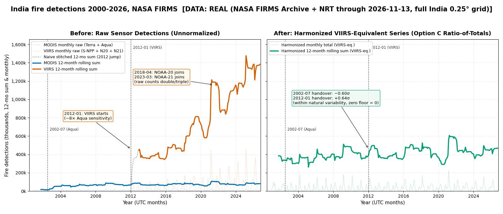

# EmberTrace

**NASA Space Apps Challenge 2026 · Challenge 15: Harmonization of MODIS and VIIRS Hot Spots**

*One continuous 26-year active-fire activity calendar across satellite generations (November 2000 – November 2026).*

Satellites have mapped active fires for over 25 years, but the historical record is split across two sensor families that cannot be compared directly. **MODIS** (*Terra* from Nov 2000, *Aqua* from Jul 2002; ~1 km pixels) provides the long historical baseline, while **VIIRS** (*Suomi-NPP* from Jan 2012, *NOAA-20* from Apr 2018, *NOAA-21* from Mar 2023; 375 m pixels) detects roughly **8× as many hotspots** for the same fire activity. Joining raw counts creates large artificial jumps whenever sensors or satellite fleet sizes change.

**EmberTrace** converts **18.0 million real NASA FIRMS detections across India** (`2000-11-01` to `2026-11-13`) into **one continuous, VIIRS-equivalent monthly series on a `0.25°` grid** (`4,651` active cells × `313` calendar months). An interactive web application lets emergency responders, land managers, and scientists select any area and date range to inspect:

- **3D Interactive Story Globe** — scroll-driven 3D visualization of India’s harmonized fire climatology alongside worldwide 7-day VIIRS context and satellite fleet evolution (`2000–2026`)
- **Burning Activity Calendar** — a `27-year × 12-month` heatmap (`2000–2026`) of monthly VIIRS-equivalent fire detections rendered on a colorblind-safe Viridis scale
- **Historical Anomaly Calendar** — each month compared against the full-record historical median of that same calendar month (`value / median`) on a colorblind-safe diverging Blue-to-Orange log-2 scale centered at `1.0×`
- **Top Anomalies & Data-Quality Flags** — non-blocking provenance and uncertainty markers for converted MODIS years (`2002–2011`), chained Terra months (`2000–2002`), provisional Near-Real-Time (NRT) months (`2026-08+`), partial current months (`2026-11`), sparse low-count areas, and unobserved (`unavailable`) months
- **Self-Documented Exports** — CSV table downloads with metadata headers plus high-resolution PNG and SVG chart exports



---

## Project Status (`pipeline_version: 0.3-monthly-ratio`)

| Component | Status | Summary |
|---|---|---|
| **Stages 1–4: Ingest, Filter, Grid & Normalize** (`pipeline/ingest/`) | ✅ Complete | Validated on `18,035,986` real NASA FIRMS detections over India (`2000-11-01` to `2026-11-13`); removes `159` verified outage days (`docs/08`) and masks `54,881` static industrial/flare NRT hits to within `±4%` (`docs/10`) |
| **Stages 5–7: Calibration, Harmonization & Calendar** (`pipeline/model/`) | ✅ Complete | Zero-preserving calendar-month ratio calibration (`0.3-monthly-ratio`, `Jun–Sep` monsoon pooled); cuts median hold-out error to **`8.7%`** (`r = 0.996`) on `Aqua → VIIRS` and **`24.1%`** (`r = 0.973`) on `Terra → Aqua` (`docs/11-calibration-report.md`) |
| **Precomputed Production Dataset** (`data/`) | ✅ Complete | `data/cell_month.parquet` (`2.3 MB`, `1,455,763` rows across `4,651` `0.25°` cells × `313` months), `data/meta.json`, and `data/calibration.json` |
| **FastAPI Backend** (`api/`) | ✅ Complete | Serves `/api/meta`, `/api/presets`, `/api/calendar`, and `/api/download/csv` with strict `unavailable` (`null`) vs. `zero` (`0.0`) semantics and contract tests (`contracts/`) |
| **React + TypeScript Web App & 3D Story Globe** (`web/`) | ✅ Complete | Interactive Leaflet bounding-box selector with `0.25°` grid-snap preview, Viridis & diverging Blue↔Orange SVG heatmaps, interactive tour/explainer, PNG/SVG/CSV exports, and Three.js/GSAP story globe |
| **Cloud Deployment** (`Dockerfile`, `docs/06-deployment.md`) | ✅ Complete | Multi-stage single-container Docker build serving `/` and `/api` on Google Cloud Run (`asia-south1`) |

---

## How Harmonization Works

```text
FIRMS CSVs ──► 1 Load ──► 2 Filter & Mask ──► 3 Grid (0.25°) ──► 4 Normalize ──► 5 Calibrate ──► 6 Harmonize ──► 7 Calendar ──► FastAPI & Web UI
(MODIS C6.1,   Standard   Drop low conf;      Count per cell     Divide by       Calendar-month   VIIRS (2012+),  Year × Month   Interactive AOI,
 VIIRS S-NPP,  schema     keep type=0 in      & UTC month;       observing       ratios (Jun-Sep  Calibrated Aqua  totals +      Heatmaps, Flags,
 NOAA-20/21)              archive; 0.005°     NaN ≠ 0 when       satellites      pooled; 0→0):    (2002-07..2011), Anomaly vs    CSV & PNG/SVG
                          static mask on NRT  unobserved         minus outages   Aqua→VIIRS,      Chained Terra    full-record   downloads
                                                                                 Terra→Aqua       (2000-11..2002)  median
```

Key scientific rules enforced end-to-end:
- **`NaN ≠ 0` (`unavailable` vs. `zero`):** A month with no satellite observing is `NaN` (`null` / `unavailable`), never `0`. A month when a satellite observed zero fires is `0.0`.
- **Static Industrial Source Mask for NRT (`docs/10-nrt-static-mask.md`):** Standard archive files classify vegetation fires (`type = 0`), but recent NRT files omit `type`. During India’s monsoon (`Jul–Sep`), static industrial stacks and flares account for `44%–70%` of raw VIIRS detections. Our `0.005°` (~500 m) archive-derived static mask removes `54,881` non-vegetation NRT detections and brings NRT monthly totals within `±4%` of true vegetation counts.
- **Outage-Adjusted Satellite Normalization (`docs/08-missing-data-table.md`):** Monthly counts are divided by the effective number of observing satellites after subtracting `159` verified outage days (`69` Terra, `31` Aqua, `51` S-NPP, `6` NOAA-20, `2` NOAA-21). Combined 3-satellite normalized VIIRS matches single-satellite S-NPP within `0.1%–1.5%` across `2018–2025`.
- **Zero-Preserving Calendar-Month Calibration (`docs/11-calibration-report.md`):** Never blends sensors after January 2012. Pre-2012 MODIS counts are scaled via calendar-month ratios through the origin (`factor_m = sum(new) / sum(old)`, with low-count monsoon months `Jun–Sep` pooled) so `0` detections always remain `0.0`.

### Validation Summary (`0.3-monthly-ratio` on Real India FIRMS Data)

| Check | `Aqua → VIIRS` (`2012-01..2019-12`) | `Terra → Aqua` (`2002-08..2011-12`) | Notes |
|---|---|---|---|
| **Overall Overlap Ratio** | `7.98×` (`5.02×` Oct to `16.67×` Jun–Sep) | `2.77×` (`1.03×` May to `6.46×` Nov) | Cell-level Pearson `r = 0.890` (`0.25°`) / `0.913` (`0.50°`) |
| **70/30 Hold-Out Correlation** | **`0.9958`** *(vs. `0.9566` single factor)* | **`0.9726`** *(vs. `0.8744` single factor)* | Tested on unseen final 30% of overlap months |
| **70/30 Hold-Out Median Error** | **`8.7%`** *(vs. `19.8%` single factor)* | **`24.1%`** *(vs. `68.0%` single factor)* | Unweighted MAPE: `23.3%` (`Aqua→VIIRS`), `27.6%` (`Terra→Aqua`) |
| **Deseasonalized 12m Splice Check** | `2012-01`: **`×1.264` (`z = +0.81σ`)** | `2002-07`: **`×1.004` (`z = −0.17σ`)** | `2023-03` (NOAA-21 join): **`×0.784` (`z = −1.00σ`)**; all inside `±1σ` of natural variability (`std = 26.5%`) |
| **Strict `1 ± 5%` Overlap Check** | `2012-01`: `×0.94` (`FAIL` vs. `0.95`) | `2002-07`: `×1.09` (`FAIL` vs. `1.05`) | `2023-03` weak month-to-month: `×1.56` (`FAIL`); reported transparently without relaxing tolerance |

---

## Quick Start & Commands

### 1. Run the Full Application (Backend API + Frontend Web UI)

The repository includes the precomputed India production dataset in `data/` (`data/cell_month.parquet`, `data/meta.json`, `data/calibration.json`), so you can run the web app immediately without downloading the 1.4 GB raw CSV archive:

```bash
# 1. Start the FastAPI backend on http://localhost:8000 (serving production India data)
pip install -r api/requirements.txt -r api/requirements-dev.txt
DATA_DIR=data uvicorn api.main:app --reload --port 8000

# 2. In a second terminal, start the React + Vite frontend on http://localhost:5173
cd web
npm ci
VITE_API_URL=http://localhost:8000 npm run dev
```

Or run the entire production stack inside a single Docker container on `http://localhost:8080`:

```bash
make docker-run
```

### 2. Run the Data Pipeline & Verification Suite

Requires Python `3.11+`:

```bash
pip install -r pipeline/requirements.txt

# Run allpipeline + API unit and contract tests (63 pipeline tests + API test suite)
make test
make contract-test

# Run the synthetic planted-truth pipeline verification (runs in ~6s, no raw data needed)
make synthetic

# Run the full India pipeline from raw FIRMS files in data/raw/ (~2 min, ~4.6 GB RAM)
make pipeline
make export

# Run scientific splice checks and generate validation reports & figures
python -m science.splice_placebo
python -m science.real_report
python -m science.hero_figure
make splice-check
```

---

## Repository Structure

```text
├── api/                  # FastAPI backend (/api/meta, /api/presets, /api/calendar, /api/download/csv)
├── contracts/            # Handoff schemas (H1-H3), TypeScript API types, golden JSON fixtures & samples
├── data/                 # Precomputed production India dataset (cell_month.parquet, meta.json, calibration.json)
├── docs/                 # PRD, architecture, data profile, outage table, static mask, calibration report, submission form
├── pipeline/             # 7-stage Python pipeline (ingest/ stages 1-4, model/ stages 5-7, config.yaml, export.py)
├── planning/             # Pre-hackathon design docs, verified constants & FIRMS request receipts
├── science/              # Splice checks, placebo distribution, hold-out runbook & hero figure generator
├── scripts/              # Data profiling, outage verification, static-mask validation & 3D story globe builder
├── tools/synthetic/      # Deterministic synthetic FIRMS generator & planted-truth recovery verifier
├── web/                  # React 18 + TypeScript + Vite + Tailwind + Leaflet + Three.js frontend
├── Dockerfile            # Multi-stage single-container build for Google Cloud Run
├── Makefile              # Build, test, pipeline, export & deployment targets
└── LICENSE               # MIT License
```

---

## Documentation

See [`docs/README.md`](docs/README.md) for the full documentation index:
- [`docs/00-problem-statement.md`](docs/00-problem-statement.md) — NASA Space Apps 2026 Challenge 15 prompt & requirements
- [`docs/01-prd.md`](docs/01-prd.md) — Product Requirements Document (source of truth)
- [`docs/03-implementation-plan.md`](docs/03-implementation-plan.md) — Architecture, handoffs (`H1–H4`), and engineering plan
- [`docs/04-api-spec.md`](docs/04-api-spec.md) — REST API specification and error contracts
- [`docs/06-deployment.md`](docs/06-deployment.md) — Google Cloud Run deployment guide
- [`docs/07-data-profile.md`](docs/07-data-profile.md) — Empirical profile of all `18,035,986` raw FIRMS rows
- [`docs/08-missing-data-table.md`](docs/08-missing-data-table.md) — Satellite outage verification (`159` verified outage days)
- [`docs/10-nrt-static-mask.md`](docs/10-nrt-static-mask.md) — Near-Real-Time static industrial heat-source mask (`±4%` validation)
- [`docs/11-calibration-report.md`](docs/11-calibration-report.md) — Calibration, hold-out validation, splice checks & `0.25°` vs. `0.50°` grid comparison
- [`docs/explainer.md`](docs/explainer.md) — In-app scientific explainer & presentation slide notes
- [`docs/submission_form.md`](docs/submission_form.md) — Complete NASA Space Apps 2026 project submission text & verification table

---

## Known Scientific & Technical Limitations

We count satellite **thermal detections**, not ground-truth burned area:
- **Slight positive hold-out bias on `Aqua → VIIRS` (`mean pred/actual = 1.17`):** While median monthly hold-out error is `8.7%`, low-count monsoon months pull the unweighted mean ratio to `1.168`.
- **High uncertainty in monsoon months (`Jun–Sep` factor `≈ 16.7`):** Active-fire counts during India’s monsoon are very small (`30–100` Aqua detections/month across India), making the pooled `Jun–Sep` factor (`16.67`) roughly double the other months (`5.02–12.26`).
- **`2012-01` handover shows a `+26%` 12-month rise (`×1.264`, `+0.81σ`) and `×0.94` on the strict 5% overlap check:** Inside normal year-to-year fire variability (`±26.5%`), because 2012’s annual overlap ratio (`7.465`) was `6.4%` below the 8-year average (`7.979`).
- **Low statistical power of handover splice checks:** Because natural year-to-year fire variability over India is `±26.5%` (`1σ`), before-vs-after splice checks can only detect steps larger than `~50%` (`±2σ`). The primary evidence for calibration quality is the 8-year overlap fit (`r = 0.996`).
- **Higher uncertainty before 2012 (especially Nov 2000 – Jun 2002):** `Terra → Aqua` has a `24.1%` median monthly hold-out error, and `Aqua → VIIRS` annual ratios drift by `~10%` across `2012–2019`. Pre-2012 values—and especially the two-step chained Terra segment (`2000-11` to `2002-06`)—are best suited for seasonal and multi-year trends rather than individual months.
- **Provisional Near-Real-Time months (`2026-08` to `2026-11`):** Static-source masking leaves `±4%` residual error in NRT months (`docs/10`), and November 2026 is a partial month (through `2026-11-13`) whose anomaly is marked `non_comparable_partial`.
- **Assumed/provisional constants:** MODIS confidence thresholds (`30` / `80`), the outage neighbor-median cut-off (`20`), and static-mask parameters (`0.005°`, `min_hits = 5`) are configuration values in `pipeline/config.yaml`.

---

## Data Credits

We acknowledge the use of data from **NASA's Fire Information for Resource Management System (FIRMS)** (`https://earthdata.nasa.gov/firms`), part of NASA's Earth Observing System Data and Information System (EOSDIS):
- **MODIS Collection 6.1** active-fire detections (*Terra* and *Aqua*, `MCD14ML` / `MCD14DL`), Request ID `845077` — DOI: [`10.5067/FIRMS/MODIS/MCD14ML`](https://doi.org/10.5067/FIRMS/MODIS/MCD14ML)
- **VIIRS 375 m Collection 2** active-fire detections (*Suomi-NPP* `VNP14IMGT` Request ID `845080`, *NOAA-20* Request ID `845078`, and *NOAA-21* Request ID `845079`) — DOI: [`10.5067/FIRMS/VIIRS/VNP14IMGT_NRT.002`](https://doi.org/10.5067/FIRMS/VIIRS/VNP14IMGT_NRT.002)
- **NASA FIRMS Missing Data Table** (`API / missing_dates`, v2.13.6, verified in `docs/08-missing-data-table.md`)
- **OpenStreetMap** basemap tiles (© OpenStreetMap contributors, ODbL)

## License

Released under the [MIT License](LICENSE).
