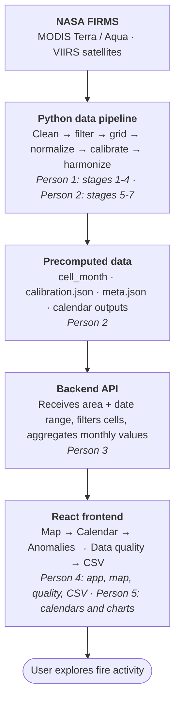
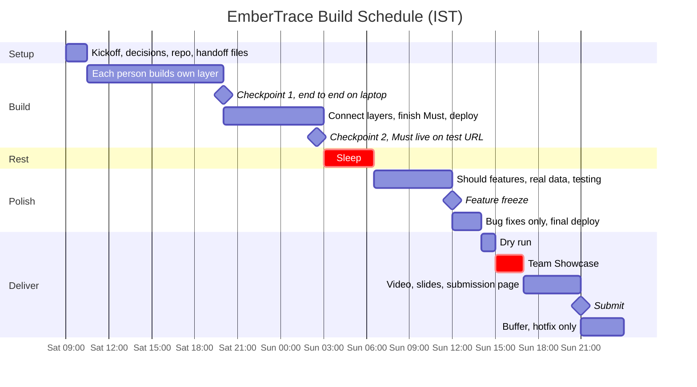

# EmberTrace: Team Implementation Plan

**NASA Space Apps Challenge 2026 · Challenge 15: Harmonization of MODIS and VIIRS Hot Spots**
**Build window:** Sat 14 Nov 09:00 → Sun 15 Nov 23:59 (IST) · **Team:** 5 engineers · **Target submit:** Sun 21:00

---

## 0. The Plan in One Minute

1. **We build five layers, and each person owns one.** Nobody writes code in another person's folder.
2. **Layers talk through handoff files.** These are fixed at 10:30 Saturday and do not change without the whole team agreeing.
3. **Everyone can start immediately.** Each layer is built against sample input (synthetic data or mock API responses), so nobody waits on anybody.
4. **We connect everything at 20:00 Saturday, deploy by 02:30 Sunday, sleep 03:00 to 06:30, freeze features at 12:00 Sunday, and submit at 21:00 Sunday.**
5. **Everyone writes code, and everyone takes one part of the submission** (slides, video, README, submission page, science figures).

| When (IST) | What must be true |
|---|---|
| **Sat 10:30** | Repo set up, handoff files fixed, open decisions closed |
| **Sat 20:00** | Whole app works end to end on a laptop with synthetic data |
| **Sun 02:30** | All Must Have features live on a public test URL |
| **Sun 03:00 to 06:30** | Sleep |
| **Sun 12:00** | Feature freeze: only bug fixes after this |
| **Sun 14:00** | Final version deployed |
| **Sun 15:00 to 17:00** | Team Showcase (remote, 5 minutes) |
| **Sun 21:00** | Project submitted (deadline 23:59) |

> **Check before 09:00:** the deadline is 11:59 PM in the *time zone of the event you registered for*. This plan uses IST. If your event is in another time zone, shift all times.

---

## 1. How the System Fits Together



### Who owns each layer

| Layer | Owner | What they deliver | Starts from (no waiting) |
|---|---|---|---|
| **Pipeline, stages 1 to 4**: clean, filter, grid, normalize | **Person 1** | A per-cell, per-month, per-satellite table with NaN and 0 kept separate | The pipeline code (`pipeline/run.py` + `pipeline/ingest/`, split from `harmonize.py` in ING-1) + the real FIRMS archive in `data/raw/` (see `docs/07-data-profile.md`) + synthetic data |
| **Pipeline, stages 5 to 7 + precomputed data**: calibrate, harmonize, calendar, export | **Person 2** | `cell_month.parquet`, `calibration.json`, `meta.json`, and the automated "no jump" check | A small sample of Person 1's table (generated in the first hour from today's code) |
| **Backend API** | **Person 3** | `GET /api/meta`, `POST /api/calendar`, `POST /api/download/monthly.csv`, deployment | A sample `cell_month.parquet` from Person 2 (first hour) and the API spec. **Until H2 lands:** the stand-in sample in `contracts/samples/` (`cell_month.central-india.csv` + `meta.central-india.json`; read its README) |
| **Frontend: app, map, controls, data quality** | **Person 4** | Map selection, date range, API connection, warnings panel, CSV button, explainer | Mock API responses (already in the API spec) |
| **Frontend: charts** | **Person 5** | Fire activity calendar, anomaly calendar, legends, provenance markers, chart export | Mock API responses (already in the API spec) |

### The four handoff files (the only things two people share)

| # | Handoff | Written by | Read by | What it contains |
|---|---|---|---|---|
| H1 | `contracts/normalized.schema.md` | Person 1 | Person 2 | Columns of the stage-4 table: cell, month, raw count and normalized value per series (Terra, Aqua, VIIRS), plus `data_through` and `provisional_from` |
| H2 | `contracts/cell_month.schema.md` + `meta.schema.json` | Person 2 | Person 3 | Columns of `cell_month`: cell, month, harmonized value, source, raw counts per series. `meta.json`: cell size, coverage, data-through date, provisional-from month, grid extent, data kind |
| H3 | `contracts/api/types.ts` + `contracts/fixtures/*.json` | Person 3 | Persons 4 and 5 | Request and response types from the API spec; mock responses for a normal area, a sparse area and an error |
| H4 | `web/src/features/charts/index.ts` (component props) | Person 5 | Person 4 | `<FireCalendar response mode="activity" \| "anomaly" showProvenance />`, `<TopMonths response />`, `exportChart(element, format)` |

**Rule:** a handoff file changes only if its writer announces it in the team channel and the readers agree. Adding a new optional field is fine with notice. Renaming or removing a field needs the whole team at a stand-up.

---

## 2. Team & Folders

Each person writes only in their own folders. That alone removes almost all merge conflicts.

| Person | Title | Owns (only they write here) |
|---|---|---|
| **Person 1** | Ingest Engineer | `pipeline/ingest/`, `pipeline/config.yaml`, `pipeline/requirements.txt`, `pipeline/run.py`, `pipeline/tests/ingest/`, `scripts/`, `contracts/normalized.schema.md`, `tools/synthetic/` |
| **Person 2** | Calibration & Data Engineer | `pipeline/model/`, `pipeline/tests/model/`, `data/`, `science/`, `contracts/cell_month.schema.md`, `contracts/meta.schema.json` |
| **Person 3** | Backend Engineer | `api/`, `contracts/api/`, `contracts/fixtures/`, `Dockerfile`, `.dockerignore`, `.gcloudignore`, `Makefile`, `docs/06-deployment.md` |
| **Person 4** | Frontend Engineer: App & Map | `web/` setup files, `web/src/app/`, `web/src/api/`, `web/src/features/map/`, `web/src/features/controls/`, `web/src/features/quality/`, `web/src/features/explainer/`, `web/src/features/downloads/` |
| **Person 5** | Frontend Engineer: Charts | `web/src/features/charts/`, `web/src/features/insights/`, `web/src/styles/scales.ts`, `web/src/dev/ChartPlayground.tsx` |
| Everyone | | `TASKS.md` (tick your own lines), `docs/submission/` (your own section) |

```text
embertrace/
├── TASKS.md                       everyone (own lines only)
├── Makefile                       Person 3 (deploy targets exist)
├── Dockerfile  .dockerignore  .gcloudignore   Person 3 (Cloud Run, docs/06)
├── contracts/
│   ├── normalized.schema.md       Person 1
│   ├── cell_month.schema.md       Person 2
│   ├── meta.schema.json           Person 2
│   ├── api/types.ts               Person 3
│   └── fixtures/*.json            Person 3
├── pipeline/
│   ├── requirements.txt           Person 1
│   ├── config.yaml                Person 1
│   ├── ingest/  (stages 1-4)      Person 1
│   ├── model/   (stages 5-7)      Person 2
│   └── run.py                     Person 1 (calls ingest, then model)
├── scripts/profile_raw.py         Person 1 (raw data profile -> docs/07)
├── tools/synthetic/               Person 1
├── data/                          Person 2 (build outputs; real archive in data/raw/, gitignored)
├── science/                       Person 2
├── api/                           Person 3
├── web/
│   └── src/
│       ├── app/  api/             Person 4
│       ├── features/map/ controls/ quality/ explainer/ downloads/   Person 4
│       ├── features/charts/ insights/                               Person 5
│       └── styles/scales.ts  dev/ChartPlayground.tsx                Person 5
└── docs/                          shared; docs/submission/ everyone
```

**Tech stack** (confirm at kickoff): Python + pandas + pyarrow for the pipeline; FastAPI for the API; React + Vite + TypeScript, react-leaflet + leaflet-draw for the map, D3 scales + SVG for the charts; one Docker container on Google Cloud Run (`asia-south1`) serves the API under `/api` and the built frontend at `/` (see `docs/06-deployment.md`).

---

## 3. Schedule



| Block | Time (IST) | Goal | Done when |
|---|---|---|---|
| **A. Setup** | Sat 09:00 to 10:30 | Everyone can start alone | Repo runs; H1 to H4 committed; decisions recorded |
| **B. Build** | Sat 10:30 to 20:00 | Each layer works on its own sample input | Each person's Block B checklist ticked |
| **Checkpoint 1** | Sat 20:00 (30 min) | Real pipeline → real API → real UI on one laptop | Full user journey works on synthetic data |
| **C. Connect & deploy** | Sat 20:30 to Sun 03:00 | Every Must Have works, on a public test URL | Checkpoint 2 at 02:30 passes |
| **Sleep** | Sun 03:00 to 06:30 | Rest | Alarms set for 06:30 |
| **D. Polish** | Sun 06:30 to 12:00 | Should features, real data if available, cross-testing | Feature freeze at 12:00 |
| **E. Stabilize** | Sun 12:00 to 14:00 | Fix bugs only | Final deploy at 14:00 |
| **F. Deliver** | Sun 14:00 to 21:00 | Showcase, demo video, slides, submission | Submitted at 21:00 |

**Stand-ups** (10 minutes on a call): Sat 09:00, 14:00, 20:00, Sun 02:30, 06:30, 12:00, 17:00. Post blockers in the channel as soon as they appear.

---

## 4. Setup Block (Sat 09:00 to 10:30, everyone)

| Time | Who | Task |
|---|---|---|
| 09:00 to 09:20 | All | Walk through this plan and the architecture diagram. Confirm the deadline time zone |
| 09:20 to 09:45 | All | Close the open decisions (table below). One person types them into `docs/DECISIONS.md` |
| 09:45 to 10:30 | Person 3 | Create folders and `TASKS.md`; extend `Makefile` (`.gitignore`, `Dockerfile` and the deploy targets already exist) |
| 09:45 to 10:30 | Person 1 | Split `pipeline/harmonize.py` into `pipeline/ingest/` (stages 1 to 4) and `pipeline/model/` (stages 5 to 7) with **no behavior change** (no tests exist yet: compare the output files of both versions on the same input). Commit H1 and a sample normalized table |
| 09:45 to 10:30 | Person 2 | Write H2 (`cell_month` schema + `meta.json`) and commit a **sample `cell_month.parquet`** built from today's code |
| 09:45 to 10:30 | Person 3 | Write H3: `types.ts` and full-length mock responses (313 months) from the API spec examples |
| 09:45 to 10:30 | Persons 4 & 5 | Agree H4 (chart component props). Person 4 sets up the React app; Person 5 creates the chart playground page that loads the mock files |

### Decisions to close (proposed answer in bold)

| Topic | Decision |
|---|---|
| Anomaly baseline | **Full record**, so narrowing the date range never changes what 1.0 means; UI shows "Baseline: N years" |
| Cell size | **0.25°**, read from `meta.json` everywhere, so changing it later needs no code change |
| Provisional (near-real-time) flag | **Written by the pipeline into `meta.json`** as `provisional_from` |
| Low-count threshold, minimum years for a median | **Config values with placeholder defaults**, labeled provisional until real data |
| Polygon selection | **Should**: only after all Must Haves are live |
| Raw detections download | **Endpoint returns 501** (Could, not built) |
| FRP (fire radiative power) | **Cut**: no conversion between sensors exists for it |
| Partial current month | **Labeled partial**; its anomaly is shown as not comparable |
| Calibration scope | **One fit per satellite pair** for the whole region, never per selected area |
| Hosting | **One container on Google Cloud Run** (`asia-south1`): API under `/api`, built frontend at `/`, data baked into the image (`docs/06-deployment.md`). Backup: frontend in mock mode on GitHub Pages |

### Corrections from the verified constants (apply in setup)

| Item | Action | Owner |
|---|---|---|
| NOAA-21 start | ~~Change config to 17 Jan 2024~~ **Superseded:** keep **1 Mar 2023**. The real archive file (`J2V-C2`) has detections from 2023-03-01 (about 448k in 2023), see `docs/07-data-profile.md` | Person 1 |
| S-NPP end | **2 Nov 2026 13:00 UTC** in config | Person 1 |
| Terra and Aqua end dates | **Do not hard-code**; sources conflict | Person 1 |
| MODIS confidence thresholds 30 / 80 | **Assumed**, not verified against the FIRMS user guide. Keep them, and label them "assumed" in docs, config and the submission | Person 1 |
| VIIRS archive letters `l/n/h` and `type` column | **Verified** on the real files (`docs/07-data-profile.md`): VIIRS confidence is `l/n/h` in archive and NRT; archive files have `type`, NRT files do not | Person 1 |
| ~~PRD text that still says NOAA-21 from 2023~~ | Not needed: the PRD date is correct (it can drop the [Unverified] label) | Person 2 |

---

## 5. Each Person's Work

Every person has about the same amount of work: around 9 to 10 build tasks, plus one submission item. Task IDs go in branch names and commit messages.

### Person 1: Ingest Engineer (pipeline stages 1 to 4)

**Goal:** turn raw FIRMS files into a clean, per-satellite, per-cell monthly table that Person 2 can trust.

| ID | Block | Task | Done when |
|---|---|---|---|
| ING-1 | A | Split `pipeline/harmonize.py` into `ingest/` and `model/`; write H1 | Split version writes identical output files to `pipeline/harmonize.py` on the same input (no tests exist yet) |
| ING-2 | A | Apply the config corrections (NOAA-21, S-NPP end, no hard-coded Terra/Aqua end) | Test shows no step at 2023-03 (NOAA-21 joins) |
| ING-3 | B | Loader: NRT text format and archive CSV format; **sensor detected from the satellite name** (real VIIRS files use MODIS-style column names) | All 8 files in `data/raw/` and the two sample files load |
| ING-4 | B | ~~`first_file_check.py`~~ **Done:** `scripts/profile_raw.py` writes `docs/07-data-profile.md` (40 PASS, 0 FAIL on the real files) | Rerun whenever the raw data changes |
| ING-5 | B | Filter (drop low confidence, keep type 0 where present) and grid at the configured cell size; **empty cells filled with 0** | Unit tests for both. **Done:** `filter_detections`, `grid_counts`, `normalize` in `pipeline/ingest/aggregate.py`; filter drops are reported per rule |
| ING-6 | B | Normalize by satellites flying, fractional weights for partial months; **NaN when no satellite flies**. Count **observed days** per satellite per month = mission days minus outage days. Rule: a satellite-day is an **outage** only if our data has **zero detections** for that satellite that day **and** (FIRMS lists it **or** the neighbouring days are clearly non-zero). Any day with at least one detection is observed, even if FIRMS lists it. `scripts/check_outages.py --csv` produces the list from `docs/08-missing-data-table.md` and the raw files; the "clearly non-zero" cut-off is a config placeholder, labeled provisional. An outage must never read as zero fires | Unit tests: Terra before Nov 2000 gives NaN; quiet cell gives 0; an outage day lowers the weight |
| ING-7 | B | **Synthetic demo generator** over 5 to 40 N, 60 to 100 E with: one bad fire season, one sparse area, a zero-median month, the current partial month, both handovers | Person 2 can run the full pipeline on it. **Done:** `make synthetic` (`tools/synthetic/README.md`) also checks the result against the planted truth |
| ING-8 | B | `data_through` and `provisional_from` computed from the input (NRT months flagged) and passed in H1 | Values appear in the normalized output |
| ING-11 | B | **NRT static-source mask** (see the method note below the table) | Mask applied to NRT; residual error measured on the last archive months and posted |
| ING-9 | C | `make pipeline` runs ingest + model end to end in one command; performance check on the full grid | One command rebuilds all data |
| ING-10 | D | **Real archive is in `data/raw/`** (India, 2000-11 to 2026-11-13): ingest a small region first, then the full region | Real normalized table for Person 2, or a note saying why not |
| **Submission** | F | README: what EmberTrace is, how to run it, data credits (NASA FIRMS links) | README reviewed by one teammate. **Drafted 14 Nov:** pipeline, data credits, limitations and future work are done; app run steps are added when `api/` and `web/` merge |

**Method note: NRT static-source mask (ING-11).** Archive files tag every detection with `type` (0 = vegetation fire, 1 = volcano, 2 = other static land source such as industry, 3 = offshore). NRT files have no `type`, so the type 0 filter can't run on them. Static sources stay in the same place over the years, though, so the archive tells us where they are:

1. **Build the mask** from the archive: every location (rounded to `nrt_mask.cell_deg`) with at least `nrt_mask.min_hits` detections of type 1, 2 or 3, kept separately for MODIS and VIIRS. Both settings are config values with placeholder defaults (`0.01°` ≈ 1 km, `1`), labeled provisional.
2. **Apply it to NRT**: drop NRT detections inside the mask, then filter on confidence as usual.
3. **Validate on archive data**: take the last 3 archive months, ignore their `type`, apply the mask, and compare with the true type 0 counts. Post the residual error per sensor, tune the two settings if needed, and report the result as a limitation.
4. **Never silent**: log how many NRT rows the mask dropped per sensor and month. NRT months stay labeled provisional in any case.

### Person 2: Calibration & Data Engineer (stages 5 to 7 + precomputed data)

**Goal:** produce the harmonized data the API serves, and prove there is no jump at the sensor handovers.

| ID | Block | Task | Done when |
|---|---|---|---|
| CAL-1 | A | Write H2 schemas; commit a sample `cell_month.parquet` + `meta.json`. **Done by Person 1 (14 Nov), Person 2 to confirm:** H2 in `contracts/cell_month.schema.md` + `contracts/meta.schema.json`; `data/` holds the full India export | Person 3 can load them |
| CAL-2 | B | Calibrate: Aqua to VIIRS on 2012 to 2019, Terra to Aqua on Aug 2002 to Dec 2011, bias factor, 70/30 hold-out, fit guard. **⚠️ The conversions must keep 0 detections at 0.** Today `apply_log_line(0) > 0` (positive intercept): in the central India sample a cell with 0 detections becomes 4.4 (Aqua) or 14.2 (chained Terra). See AGENTS.md, Known issues. **Known-answer test:** `make synthetic` (synthetic data with a planted answer, about 6 s, `tools/synthetic/README.md`); after the fix, section 3 of its check should match the truth | Planted synthetic relationship recovered; one-day sample refused; **a cell with 0 detections converts to 0** |
| CAL-3 | B | Harmonize: source per month (VIIRS from 2012, calibrated Aqua Jul 2002 to Dec 2011, chained Terra before); never blend after 2012. A month with 0 detections must stay `zero` before 2012 too (see CAL-2) | Unit tests per period, including a 0-detection cell in each period |
| CAL-4 | B | Export: `cell_month.parquet` (with raw counts per series for the low-count flag), `calibration.json`, `meta.json`. H2 must state that raw counts are 0 even when a satellite wasn't flying, so NaN vs 0 comes from the harmonized value / `source`, never from a raw count (see H1). **Done by Person 1 (14 Nov):** `pipeline/export.py` / `make export`; checks everything the API loader rejects; tested with Person 3's loader and API on the full India run | Matches H2 exactly |
| CAL-5 | B | `science/splice_check.py`: pass/fail at **2002-07, 2012-01 and 2023-03** (NOAA-21 joins); added to `make test`. **Done by Person 1 (14 Nov):** `make splice-check`. Source handovers compare both sources (converted) in the 12 months after; 2023-03 gets a weaker month-to-month check; synthetic is also checked against the truth. Today FAIL at 2002-07 (×0.38) and 2012-01 (×0.77). It's a separate target until the calibration fix makes it pass, then it moves into `make test` | Runs on every pipeline change |
| CAL-6 | B | Cell size check: 0.25° vs 0.5° on synthetic data; post the result | Decision confirmed or changed via `meta.json` |
| CAL-7 | C | **Hero figure:** raw MODIS + VIIRS counts (visible jump at 2012) next to the harmonized series (no jump), labeled synthetic | PNG in `science/figures/` |
| CAL-8 | C | Real-data runbook + scripts: overlap plot 2012 to 2019, drift check 2020 onward, hold-out errors, known bad season check | Ready to run in one command |
| CAL-9 | D | **Run the runbook on the real data** (in `data/raw/`); at 12:00 decide go or no-go (rule in section 7) | Result posted, weak results reported honestly |
| CAL-10 | D | Plain-language harmonization facts for the in-app explainer (sent to Person 4) | Text in `docs/explainer.md` |
| **Submission** | F | Two slides: "How harmonization works" and "Limitations"; answers science questions at the Showcase | Slides in the shared deck |

### Person 3: Backend Engineer (API)

**Goal:** an API that matches the spec exactly and never returns a wrong or partial answer.

| ID | Block | Task | Done when |
|---|---|---|---|
| API-1 | A | Repo setup, `Makefile`, H3 (`types.ts` + full-length mock files) | Persons 4 and 5 are building on the mocks |
| API-2 | B | FastAPI app; load `cell_month.parquet` and `meta.json` at startup (until H2 lands, load the stand-in `contracts/samples/cell_month.central-india.csv` + `meta.central-india.json`; keep loading in one place); `GET /api/meta` | Returns the spec shape |
| API-3 | B | `POST /api/calendar` input checks: lat/lon ranges, min < max, valid months inside coverage; all error codes (`INVALID_AOI`, `INVALID_DATES`, `EMPTY_AREA`, `OUT_OF_COVERAGE`) | Each error case tested |
| API-4 | B | Snap area outward to whole cells; select cells; sum per month; `state` = value / zero / unavailable | NaN never becomes 0 |
| API-5 | B | Anomaly: value ÷ full-record median for the same calendar month; states `ok`, `not_defined`, `not_enough_history`, `non_comparable_partial`, `unavailable` | Zero median gives `not_defined`, never infinity |
| API-6 | B | Flags and warnings: `source`, `provisional`, `partial`, `low_count`; the six warning codes with month ranges | Matches spec section 5.5 |
| API-7 | C | `POST /api/download/monthly.csv` (comment header, unavailable = empty, never 0); `/api/download/detections.csv` returns 501 | CSV rows equal the calendar response |
| API-8 | C | Contract tests (all 11 cases in spec section 10) + `make fixtures` regenerates the mock files from the live API | `make contract-test` green |
| API-9 | C | **Deploy** to Cloud Run with `make deploy` (`docs/06-deployment.md`): API + built frontend on one origin (no CORS needed), `GET /api/health`; public test URL by 02:30 | URL shared in channel |
| API-10 | D | Polygon areas (cell center inside polygon), only if all Must Haves are live | Tested with one polygon |
| **Submission** | F | Submission page: fill every field, add the live app and repo links, test all links logged out; press Submit at 21:00 | Confirmation screenshot posted |

### Person 4: Frontend Engineer, App & Map

**Goal:** the user can pick an area and dates, understand the data quality, and download the CSV.

| ID | Block | Task | Done when |
|---|---|---|---|
| APP-1 | A | React + Vite + TypeScript app, layout, state store | App opens with mock data |
| APP-2 | B | `web/src/api/client.ts`: typed calls to `/api/meta`, `/api/calendar`, CSV; `VITE_USE_MOCKS` switch | One variable switches mock to live |
| APP-3 | B | Map: draw a rectangle; show the requested area **and** the analyzed (snapped) area | Both shapes visible |
| APP-4 | B | Lat/lon input form in two-way sync with the map; input checks with clear messages | Editing either updates the other |
| APP-5 | B | Date range: start/end month pickers limited to coverage, "Full record" reset, latest month shown | Cannot pick outside coverage |
| APP-6 | B | Data quality panel: synthetic-data banner, snap notice with cell size, all warnings with their month ranges, never blocking results | Every warning code has text |
| APP-7 | C | Error states for every API error; loading state; empty state | Each error shows its message |
| APP-8 | C | CSV download button (filename includes area and range); harmonization explainer panel using Person 2's text | CSV downloads on the test URL |
| APP-9 | D | Accessibility for controls: keyboard focus, labels, screen-reader names; polygon drawing if API-10 is done | Keyboard-only walkthrough works |
| **Submission** | F | **30-second demo video with English subtitles**, hosted publicly | Link posted by 20:00 |

### Person 5: Frontend Engineer, Charts

**Goal:** the two calendars are clear, honest about data quality, and readable without relying on color.

| ID | Block | Task | Done when |
|---|---|---|---|
| CHT-1 | A | Agree H4 props with Person 4; chart playground page loading the mock files | Playground shows raw mock data |
| CHT-2 | B | `Heatmap` base: years as rows, months as columns; **three states** (value, zero, unavailable) that differ by pattern, not only color; months before Nov 2000 shown unavailable | Visible on normal and sparse mocks |
| CHT-3 | B | Fire activity calendar: colorblind-safe sequential scale (Cividis or Viridis), legend, hover tooltip with exact value and source | Value always readable on hover |
| CHT-4 | B | Anomaly calendar: blue (below) to orange (above), **centered on 1.0**, colored on log2 so 0.5× and 2× look equally far; distinct patterns for not defined, not enough history and partial | Sparse mock shows all states correctly |
| CHT-5 | B | Provenance: subtle side label on converted years (before 2012), "lower confidence" marker on Nov 2000 to Jun 2002 with a notice; must not change colors or create a visible step | Toggle on/off, default on |
| CHT-6 | C | Provisional months (dotted outline + "P") and partial month (hatched, anomaly muted) | Latest months marked on the normal mock |
| CHT-7 | C | Plug charts into Person 4's page via H4; check with live API data | Charts render from the test URL |
| CHT-8 | D | Chart export as PNG and SVG including legend and markers | Downloaded image matches the screen |
| CHT-9 | D | "Top 5 most active months" table; accessibility for charts (text alternative, keyboard on cells) | Table matches calendar values |
| **Submission** | F | Slide deck (max 7 slides, English) and **presents** at the Showcase | Deck link posted by 14:00 |

### Workload balance check

| Person | Build tasks | Submission item | Heaviest block |
|---|---|---|---|
| Person 1 | 10 | README | B (loader, grid, normalize, synthetic data) |
| Person 2 | 10 | 2 slides + science Q&A | B (calibration, harmonize, export) |
| Person 3 | 10 | Submission page | B (calendar endpoint) |
| Person 4 | 9 | Demo video | B (map and controls) |
| Person 5 | 9 | Slide deck + presenting | B (two calendars) |

If someone finishes early, they pick up an open task from `TASKS.md` **only after talking to its owner**, and work in a separate file.

---

## 6. How We Work Together

### Git rules
```bash
# Branch: person number + task ID
git checkout -b p3/API-5-anomaly

# Commit: area + what + task ID
git commit -m "feat(api): anomaly states for zero median [API-5]"
```
- Small pull requests (under about 300 lines), one reviewer, merge to `main`.
- `make test` and `make contract-test` pass before every merge.
- Credentials only in a local `.env`. Real archive files never go in git.

### Pull request checklist
- [ ] I changed only files in my own folders.
- [ ] NaN and 0 are still different wherever I touched data.
- [ ] No hard-coded satellite dates, cell size, thresholds or provisional months.
- [ ] Task ID is in the branch and commit; my line in `TASKS.md` is ticked.

### Cross-testing (so nobody tests only their own work)

From Sunday 06:30, each person tests another person's layer against the PRD checks and files bugs in `TASKS.md` under the owner's name.

| Tester | Tests the work of | Checks (PRD section 10) |
|---|---|---|
| Person 1 | Person 2 | V1, V2 no step at handovers; V11 fit guard |
| Person 2 | Person 3 | V4 NaN vs 0; V9 CSV matches display; V12 zero median |
| Person 3 | Person 4 | V7 snapping notice; V8 invalid input messages |
| Person 4 | Person 5 | V3 both calendars; V5 provisional; V6 partial; color-free reading |
| Person 5 | Person 1 | V10 low-count warning; V13 both file formats load |

### Quick commands
```bash
make pipeline        # build the data (ingest + model), synthetic or real
make api             # run the API locally
make web             # run the frontend on mock data
make web-live        # run the frontend against the local API
make test            # all tests, including the "no jump" check
make contract-test   # mock files = live API = types.ts
make fixtures        # regenerate mock files from the live API
```

---

## 7. Risks and What We Do

| Risk | What we do | Who decides |
|---|---|---|
| ~~Real FIRMS archive never arrives~~ | **Resolved:** the archive arrived on 14 Nov (`data/raw/`, `docs/07-data-profile.md`). Synthetic data, labeled "Demonstration data" everywhere, stays the fallback if the real run fails or fails the 12:00 check | Person 2 |
| Real data arrives but shows a jump | **At 12:00 Sunday:** use real data only if there is no step at 2002-07, 2012-01 and 2023-03 (NOAA-21 joins; same check as CAL-5). Otherwise demo synthetic and present the real results as a limitation | Person 2 |
| NRT files have no `type` column | Static sources are 20 to 70% of detections in the monsoon, so unmasked NRT months were 2 to 4× too high. **Done (ING-11):** the static-source mask brings them within about ±4% (`docs/10`). Keep months labeled provisional and report the ±4% as a limitation | Persons 1 and 2 |
| API host is down during the demo | Frontend in mock mode on GitHub Pages as backup | Person 3 |
| Someone falls behind | At the 02:30 stand-up, move one task to whoever is ahead; the folder moves with it | Team |
| New ideas late in the build | No new features after 12:00 Sunday. Ideas go into "Future work" in the README | Team |
| Showcase feedback | Only fixes under 30 minutes in one person's folder. Submission time does not move | Team |

---

## 8. Submission Checklist

| Item | Owner | Due |
|---|---|---|
| Project page created on spaceappschallenge.org (draft) | Person 3 | Sat 14:00 |
| Hero figure (raw vs harmonized) | Person 2 | Sun 02:30 |
| Slide deck, max 7 slides, English | Person 5 (Person 2 adds 2 slides) | Sun 14:00 |
| Showcase: Person 5 presents, Person 4 drives the live demo, Person 2 answers science questions | All | Sun 15:00 |
| 30-second demo video with English subtitles, public link | Person 4 | Sun 20:00 |
| README with run steps, data credits, limitations, future work | Person 1 | Sun 20:00 |
| Every submission field filled; repo and live app public; links tested logged out | Person 3 | Sun 20:45 |
| **Submit** | Person 3 | **Sun 21:00** |
| On call for hotfixes until 23:59 | Person 3 + Person 4 | Sun 21:00 to 23:59 |

**What the submission must say clearly:** numbers are synthetic demonstration data (unless real data passed the 12:00 check); the data source is NASA FIRMS (MODIS Terra and Aqua, VIIRS S-NPP, NOAA-20, NOAA-21); and the limitations from PRD section 11.
