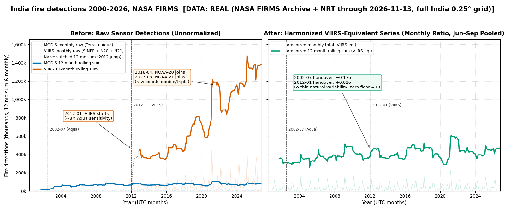

# How Harmonization Works (`CAL-10`: In-App Explainer & Slide Text)

---

## 1. Plain-Language Explainer (For the App Panel)

### Why Raw Satellite Counts Cannot Be Compared Directly
EmberTrace combines active-fire detections from two NASA sensor families spanning November 2000 to today:
- **MODIS** (*Terra* from Nov 2000; *Aqua* from Jul 2002) has a ~1 km pixel footprint and provides the first 11 years of the record.
- **VIIRS** (*Suomi-NPP* from Jan 2012 to Nov 2026; *NOAA-20* from Apr 2018; *NOAA-21* from Mar 2023) has a finer 375 m pixel footprint and detects **~8× as many hotspots** as MODIS Aqua for the same fire activity.

Stitching raw counts together creates artificial jumps in January 2012 (when VIIRS begins), April 2018 (when NOAA-20 joins), and March 2023 (when NOAA-21 joins).

### How EmberTrace Harmonizes the Record
Every month on the 0.25° grid is expressed in **VIIRS-equivalent detections per satellite**:
1. **Filter non-fire & low-confidence detections:** Drop low-confidence hits and non-vegetation static heat sources (factories, flares, offshore platforms). For recent near-real-time (NRT) months where NASA omits the `type` code, apply a spatial static-source mask built from the 25-year archive (`±4%` residual error).
2. **Account for satellite count & outages:** Divide each series' monthly cell count by the fraction of satellites actually observing that month (removing verified satellite outage days). Months with no satellite observing remain **`unavailable` (`NaN`)**, never `0`.
3. **Convert pre-2012 MODIS to VIIRS-equivalent (`monthly_ratio`, Jun–Sep pooled):**
   - **Jan 2012 – Present (`VIIRS`):** Normalized VIIRS detections directly (never blended with MODIS).
   - **Jul 2002 – Dec 2011 (`AQUA_calibrated`):** Afternoon Aqua normalized detections multiplied by the 2012–2019 Aqua→VIIRS calendar-month overlap factors (overall ratio **`×7.98`**, ranging from `×5.02` in Oct and `×7.43` in Mar to `×16.67` in pooled Jun–Sep monsoon months).
   - **Nov 2000 – Jun 2002 (`TERRA_chained`, lower confidence):** Morning Terra normalized detections chained through the 2002–2011 Terra→Aqua calendar-month overlap factors (overall ratio **`×2.77`**, ranging from `×1.26` in Jun–Sep to `×4.15–6.46` in Oct–Nov) and then to VIIRS.
   - **Zero stays zero:** A quiet cell with `0` detections always converts to `0.0` (no artificial floor).

---

## 2. Showcase Slide Copy (Person 2's Two Slides)

### Slide A: How Harmonization Works (Problem Statement + Method + Hero Figure)
- **The Problem:** Stitching raw NASA FIRMS hotspot counts across 2000–2026 creates massive artificial jumps:
  - **Sensor sensitivity jump (`2012-01`):** VIIRS (375 m pixels) detects **~8× as many hotspots** as MODIS Aqua (1 km pixels) for the same fire activity.
  - **Satellite fleet jumps (`2018-04`, `2023-03`):** Adding NOAA-20 and NOAA-21 doubles and triples raw VIIRS counts without any increase in fire.
  - **Diurnal overpass shift (`2000–2002`):** Morning Terra (10:30 local) sees fewer afternoon fires than Aqua (13:30 local), with a ratio that shifts strongly by season.
- **How EmberTrace Harmonizes to VIIRS-Equivalent Detections per Satellite:**
  1. **Filter & Mask Static Sources:** Keep vegetation fires (`type == 0`, nominal/high confidence); apply an archive-derived spatial mask (`0.005°`, $\pm 4\%$ error) to near-real-time (NRT) months lacking `type`.
  2. **Per-Satellite & Outage Normalization:** Divide monthly counts by active satellite-days observing (`platform_weight`), removing verified outage days. Unobserved months stay `NaN` (`unavailable`), never `0`. Combined normalized VIIRS matches S-NPP-only within **$\pm 1.5\%$** across 2018–2025.
  3. **Calendar-Month Overlap Ratio Calibration (`monthly_ratio`, Jun–Sep pooled):**
     - **Aqua → VIIRS (`2012–2019` overlap):** Overall $\times 7.98$ (`5.0` in Oct to `16.7` in Jun–Sep). Hold-out monthly-total **$r = 0.996$**, median monthly error **$8.7\%$** (down from $19.8\%$ single-factor).
     - **Terra → Aqua (`2002–2011` overlap, chained for `2000–2002`):** Overall $\times 2.77$ (`1.26` in Jun–Sep to `6.46` in Nov). Hold-out monthly-total **$r = 0.973$**, median monthly error **$24.1\%$** (down from $68.0\%$ single-factor).
     - **Zero-preserving:** $0 \text{ detections} \mapsto 0.0$ everywhere (no false floor).
- **Visual Evidence (`science/figures/hero.png`):** Deseasonalized 12-month handover steps are **`−0.17σ` at `2002-07`** and **`+0.81σ` at `2012-01`** (well within normal year-to-year fire variability).



### Slide B: Limitations (Exact Wording)
> **Calibrated on the 2012–2019 overlap (monthly-total $r = 0.996$ with seasonal factors, $0.96$ single factor). Handover steps are within natural year-to-year variability, but the stricter 12-month overlap check (provisional ±5%) flags 2002-07 (×1.09) and 2012-01 (×0.94). 2000–2011 values carry higher uncertainty than 2012+.**

- **Slight positive bias on Aqua → VIIRS (`mean pred/actual = 1.17`):** While median hold-out error drops from **19.8% to 8.7%** (`MAPE = 23.3%`), the prediction is slightly high on average (`1.17×`) across hold-out months, pulled up by low-count monsoon months.
- **Monsoon factor uncertainty (`Jun–Sep` Aqua → VIIRS factor $\approx 17$):** The pooled Jun–Sep factor for Aqua→VIIRS is **16.7** (~17), roughly double the other months (`5.0–12.3`). The monsoon season is where calibration is least certain because active-fire counts are tiny across India (`30–100` Aqua detections/month).
- **`2012-01` is a +26% rise after the handover (`×1.264`, `+0.81σ`):** Comparing the 12 months after `2012-01` (`464k`) to the 12 months before (`367k`) shows a **+26% rise** (`2002-07` is `×1.004`, `−0.17σ`). That is within India's natural year-to-year fire variation (`±26.5%`), but it is a rise, not a flat line.
- **Low splice-check power & pre-2012 uncertainty:** Because natural year-to-year fire variability is **±26.5%** (`placebo std = 0.265`), handover checks can only detect steps larger than ~50%; the multi-year overlap fit is the primary validation. Terra→Aqua (`2000–2002` chained) still has a **24.1% median (27.6% mean)** monthly hold-out error, and the Aqua→VIIRS yearly ratio drifts **~10%** between 2012 (`7.47`) and 2019 (`8.20`).
- **Provisional NRT months (Aug 2026+):** Static-source masking leaves ~±4% residual error; Nov 2026 is a partial month.

---

## 3. Ready-to-Send Team Handoff Notes

- **To Person 3 (`export.py` + PR to `main`):**
  > Branch `p0/planning-folder-add` is pushed with `data/cell_month.parquet`, `data/meta.json` (`0.3-monthly-ratio`), and `data/calibration.json` using calendar-month ratio calibration (Jun–Sep pooled, zero floor = `0.0`, 63/63 tests passing). Please update `DEFAULT_VERSION = "0.3-monthly-ratio"` in `pipeline/export.py` (line 25) so re-running `make export` doesn't overwrite the version string, and open a PR merging `p0/planning-folder-add` into `main`. No API code changes needed.
- **To Person 1 (README commands):**
  > Stage-4 VIIRS normalization (`platform_weight`) is verified within ±1.5% of S-NPP-only across 2018–2025; no ingest changes needed. Here are the three commands for the README "How to run" section:
  > ```bash
  > python science/hero_figure.py --run out --out science/figures/hero.png
  > python science/real_report.py --run out --out out/real_report
  > python science/splice_placebo.py --run out
  > ```
- **To Person 4 (In-app explainer):**
  > Plain-language harmonization explainer text (`CAL-10`) is ready and pushed at `docs/explainer.md` (§1).
- **To Person 5 (Slide deck):**
  > Both slides ("How Harmonization Works" with `science/figures/hero.png` and "Limitations") are ready in `docs/explainer.md` (§2).

---

## 4. Post-Merge API Cross-Testing Checklist (Person 2 → Person 3)

Once `p0/planning-folder-add` is merged into `main` and the API serves `data/cell_month.parquet` (`0.3-monthly-ratio`):
1. **`NaN` vs `0` distinctness:** Query an observed quiet cell-month (0 detections) → verify `state == "zero"` and `harmonized_count == 0.0`. Query an unobserved month (`100%` outage in synthetic/test fixture) → verify `state == "unavailable"` and `harmonized_count is None` (never `0`).
2. **CSV matches screen:** Compare `POST /api/calendar` JSON cells against `POST /api/download/monthly.csv` for the same bounding box and date range → verify `harmonized_count`, `anomaly`, and `state` match row-for-row, and `unavailable` months are blank in the CSV.
3. **Zero calendar-month median:** Query a sparse bounding box where at least one calendar month has a historical median of `0` → verify `anomaly.state == "not_defined"` and `anomaly.value is None` (blank in CSV, never `Infinity` or `NaN`).
